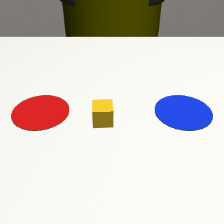

# RoboJEPA: push simulation, dataset generator and JEPA vs direct experiment



One Panda arm (robosuite), one 4 cm yellow cube, a red and a blue target disc
(colors swap sides per scene), one fixed 224x224 camera (`pushview`).
Each push is an approach-and-push primitive with three numbers:
direction `theta`, distance `dist`, sideways `offset`.

## Setup (macOS or Linux, Python 3.10 to 3.12)

```bash
python3 -m venv .venv && source .venv/bin/activate
pip install -r requirements.txt
```

`mujoco` is pinned to 3.3.7 on purpose. robosuite 1.5.2 with mujoco 3.4 or newer
fails at `suite.make(...)` with a bare `AssertionError` in
`binding_utils.get_joint_qpos_addr`. That is the error in the Colab smoke test.

On Linux without a display, prefix commands with `MUJOCO_GL=egl` (or `osmesa`).
On macOS nothing is needed.

## Run

```bash
python -m scripts.one_push                                  # 1 push to each target -> one_push.png
python -m data.generate --n-scenes 10 --out data/pilot      # 80 trajectories
python -m data.validate --data data/pilot                   # checks + contact_sheet.png
python -m data.instructions --data data/pilot               # instruction_rows.csv

python -m data.generate --n-scenes 80 --out data/v1 --workers 6   # v1: 640 trajectories
python -m data.validate --data data/v1 --determinism 5
python -m data.instructions --data data/v1
```

Run every command from the repository root (the folder containing `envs/`, `data/` and `jepa/`).

## What one scene produces

8 candidate pushes from the same start state, each with Gaussian noise on
direction (7 deg), distance (10%) and offset (1 cm):

| candidate | built as | usual outcome |
|---|---|---|
| ideal_left / ideal_right | aim at the target center, full distance | success |
| short_left / short_right | 30 to 60% of the distance | insufficient |
| over_left / over_right | 160 to 200% of the distance | overshoot, sometimes still success |
| miss | push line 6 to 9 cm beside the cube | missed contact |
| random | any direction, 5 to 25 cm | off course / wrong target |

## Trajectory file (`trajs/<traj_id>.npz`)

- `meta`: JSON with the scene (cube start, yaw, colors, split), the candidate (intended and noisy parameters) and labels
- `keyframes` (K x 224 x 224 x 3 uint8) + `keyframe_names`: initial, after_hover, after_descend, after_push, after_retract, after_home, final
- per control step (20 Hz): `phase`, `action` (7-D OSC command), `joint_pos`, `joint_vel`, `eef_pos`, `eef_quat`, `gripper_qpos`, `cube_pos`, `cube_quat`, `cube_vel`, `contact`, `contact_force`

## Labels

- `success_<side>`: cube center inside that disc (radius 6 cm) on each of the last 10 settle steps, cube still on the table. `success_red` / `success_blue` map through the scene's colors.
- `failure_mode_<side>`, judged per requested target: success, missed_contact, wrong_target, insufficient, overshoot, off_course, off_table.
- `data/validate.py` recomputes every label from the stored cube trajectory and must find 0 mismatches.

## Splits

Splits are assigned per scene (70/15/15) before simulating, so all 8 pushes and all
instructions for a scene share one split. Cube starts with x in [0.03, 0.06] are
reserved for test. Test instructions use held-out paraphrases (`data/instructions.py`).

## Known limits

- In this cloud check the Panda renders with green and blue materials. The hand is blue, which is a possible color shortcut for "blue region". It leaves the view before the final frame, but it is visible in the mid-push keyframes. Check how it looks on your machine.
- At 224 px the cube is about 20 px wide, a bit over one DINOv2 patch.
- About 2.5 s per trajectory per CPU core here. Measure it on your machine.

## Watch it live

`.venv/bin/mjpython -m scripts.watch` (3 scenes x 8 pushes in the MuJoCo viewer); `.venv/bin/mjpython -m scripts.watch --scenes 1 --only ideal_left ideal_right --speed 0.5`. On macOS the live viewer must be launched with mjpython (ships with mujoco), not python.

## JEPA vs direct classifier (offline action selection)

```bash
pip install -r requirements-jepa.txt
python -m jepa.features --data data/v1                 # frozen DINOv2-S/14 + all-MiniLM-L6-v2 features -> features.npz
python -m jepa.train_eval --data data/v1 --seeds 3     # -> jepa_results.json, jepa_results.md
```

Models (same FiLM conv trunk, width 128):

- predictor `P(z_initial, action) -> z_final` on the 16x16 DINOv2 patch grid (MSE)
- scorer `S(z_final, instruction) -> success`, trained on real final frames
- direct `D(z_initial, action, instruction) -> success`, no forecasting
- JEPA ranks the 8 candidate pushes of a scene by `S(P(z0, a), t)`; direct by `D(z0, a, t)`

Use `--device cpu` if MPS/CUDA fails. Downloads ~100 MB of weights from Hugging Face on the first run.

### Reported results (data/v1, 3 seeds, test split: 52 decisions, reserved cube band + held-out paraphrases)

| method | selection success | AUROC |
|---|---|---|
| direct | 0.417 ± 0.059 | 0.741 |
| **jepa** | **0.596 ± 0.000** | **0.859** |
| jepa_oracle (scorer on real final frame) | 0.679 ± 0.055 | 0.963 |
| state_ref (privileged coordinates) | 0.731 | 0.933 |
| random | 0.178 | |
| best_possible | 0.885 | |

Full tables (val split, position/color breakdowns, predictor MSE, latency): [`results/jepa_results.md`](results/jepa_results.md); raw per-seed numbers in `results/jepa_results.json`.
Run time on an Apple-silicon Mac (MPS): features about 1 min, training about 24 min for 3 seeds.

### Dataset download

The exact dataset behind these results (640 trajectories, about 200 MB, no `features.npz`) is attached to the
[`dataset-v1` release](https://github.com/humanwhoexplores/RoboJEPA/releases/tag/dataset-v1):

```bash
mkdir -p data && unzip robojepa_dataset_v1.zip -d data/    # gives data/v1/
python -m jepa.features --data data/v1
python -m jepa.train_eval --data data/v1 --seeds 3
```

Or regenerate it yourself: `python -m data.generate --n-scenes 80 --seed 590 --out data/v1 --workers 6` (seed 590 is the default).

### Results folder

`results/` holds copies of the small v1 outputs: `jepa_results.md/.json`, `manifest.csv`, `instruction_rows.csv`,
`config.json`, `validation_report.json`, `contact_sheet.png`, plus `one_push.png` and `push_demo.gif`.

### Replicating from scratch

`data/v1/trajs/` (205 MB) and `features.npz` (256 MB) are not in the repo. Regenerate them:

```bash
python -m data.generate --n-scenes 80 --out data/v1 --workers 6   # seed 590 by default
python -m data.validate --data data/v1 --determinism 5
python -m data.instructions --data data/v1
python -m jepa.features --data data/v1
python -m jepa.train_eval --data data/v1 --seeds 3
```

Compare your `data/v1/manifest.csv` with [`results/manifest.csv`](results/manifest.csv) to confirm the data matches. Neural-net numbers can shift slightly across hardware and library versions.
